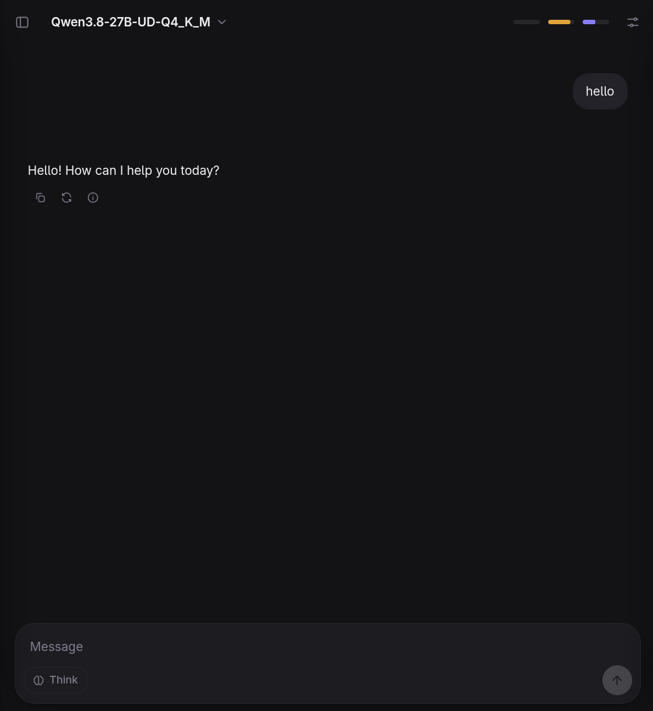

# Model Harness

A local chat app for every model you download, with a harness editor behind it.



At first glance it is a normal LLM chat: conversations on the left, a model menu at the top, a composer at the bottom. The sliders button in the top right (or Ctrl+.) opens the harness panel, where you shape how a chat talks to its model.

## Setup

These steps take a fresh machine to a working chat with a local model. Each one ends with a check you can run.

### 1. Install Node.js 22.12 or newer

```sh
node --version
```

Any version from `v22.12.0` up works. If it's missing or older, install the current LTS from [nodejs.org](https://nodejs.org) or a version manager such as `nvm`.

### 2. Install the dependencies

```sh
npm install
```

### 3. Install llama.cpp

Only needed for local GGUF models. Skip this if you'll only use Ollama, LM Studio or a hosted API.

| System | Command |
| ------ | ------- |
| macOS | `brew install llama.cpp` |
| Windows | `winget install llama.cpp` |
| Arch Linux | `sudo pacman -S llama-cpp` |
| Anything else | Download a release for your system and GPU from [github.com/ggml-org/llama.cpp/releases](https://github.com/ggml-org/llama.cpp/releases) and put `llama-server` on your `PATH` |

Check it:

```sh
llama-server --version
```

If `llama-server` isn't on your `PATH`, the app can still use it. Put its full path in Settings, Local GGUF, llama-server path.

### 4. Download a model

Put `.gguf` files anywhere inside `models/`. The app searches three folders deep. A small model that runs on most machines (2.5 GB):

```sh
mkdir -p models/qwen3-4b
curl -L --fail -C - -o models/qwen3-4b/Qwen3-4B-Q4_K_M.gguf \
  https://huggingface.co/Qwen/Qwen3-4B-GGUF/resolve/main/Qwen3-4B-Q4_K_M.gguf
```

Pick a model whose file is smaller than your GPU's VRAM to run it fully on the GPU. Bigger ones still work, split between GPU and RAM, just slower. Files named `mmproj` or `imatrix` are helper files and aren't listed as models. For a model split into parts (`-00001-of-00003.gguf`), keep all the parts in one folder.

### 5. Start it

```sh
npm run dev
```

Open [http://127.0.0.1:5173](http://127.0.0.1:5173). Set `PORT` to use another port. The server stops with an error if the port is taken, rather than picking another.

Check the server sees your model:

```sh
curl -s http://127.0.0.1:5173/api/local/models
```

The reply lists each file under `models`, with `"state": "ready"` once it has fully downloaded.

### 6. Send a message

Pick the model from the menu at the top and send a message. The first reply waits while llama-server loads the model, which takes from a few seconds to a minute. Later replies start straight away.

## Security

Keep the server on `127.0.0.1`, which is the default. The server can read and write your chats, forward your API keys, and start programs on your machine to run models. Setting `HOST=0.0.0.0` gives all of that to anyone on your network. It blocks requests from other websites, but not from other machines calling it directly.

## Other backends

Add them in Settings (gear icon, bottom left), Add provider.

| Adapter | Covers | Setting |
| ------- | ------ | ------- |
| Local GGUF (`llamacpp.ts`) | `.gguf` files in a folder. The server starts `llama-server` for the chosen file and keeps it running until you pick another. | Models folder, default `./models` |
| OpenAI compatible (`openai.ts`) | llama.cpp server, LM Studio, vLLM, SGLang, OpenRouter, OpenAI | Base URL ending in `/v1`, API key if the service needs one |
| Ollama (`ollama.ts`) | Ollama's native API | Base URL, default `http://127.0.0.1:11434` |
| Anthropic (`anthropic.ts`) | Claude through the Messages API | API key |

Requests go through the server's proxy (`/api/proxy`), so endpoints work whatever their CORS settings.

API keys have to be typed into Settings by the user. They're kept in the browser's localStorage and are never written to disk, so they can't be set up from a file.

For models bigger than your VRAM that fail to load, clear GPU layers in the Local GGUF settings so llama-server fits what it can, or set a lower number.

## Thinking

Models that can think get a Think toggle and an effort selector (Low, Medium, High) in the message box. Each chat keeps its own setting, and new chats start with the last one used.

- **Local GGUF:** the server reads each model's chat template. A template that mentions `enable_thinking` gets the toggle, sent as `chat_template_kwargs.enable_thinking`. A template that also takes `reasoning_effort` (Qwen3.8) gets real effort levels. Others get a thinking-token cap: Low 1,024, Medium 4,096, High uncapped.
- **Anthropic:** extended thinking with a token budget per effort level.
- **OpenAI compatible:** effort is sent as `reasoning_effort`. The toggle is hidden because the app cannot tell which models think.

## Harnesses

A harness sits between the conversation and the model. Each kind is a `HarnessAdapter` in `src/harnesses/`. A harness definition, which you edit in the panel, picks a kind and adds a system prompt, sampling settings and kind-specific options.

| Kind | Status |
| ---- | ------ |
| Direct | Works. Sends the chat with your system prompt and settings. |
| pi | Stub. Will run the pi coding agent as an external process. |
| Custom command | Stub. Will run any agent CLI you point it at. |

The Tools, Agent loop and Hooks sections in the panel are placeholders for now.

## Storage

Chats, providers and harnesses are saved as JSON files in `data/`, which git ignores:

- `data/state.json` holds providers, harnesses and the selected model.
- `data/chats/<id>.json` holds one conversation each.

The server writes them, so they survive browser changes, port changes and clearing site data. Set `MODEL_HARNESS_DATA` to keep them somewhere else. With no `data/` folder, the app starts with one Local GGUF provider pointed at `./models`.

`models/` is ignored by git too.

## Adding a backend

Each kind of backend is an adapter in `src/adapters/`. All of them implement `ModelAdapter` from `src/adapters/types.ts`: list the models, then stream a chat as `text`, `reasoning`, `status` and `usage` events. Write one and add it to `src/adapters/registry.ts`, and it shows up under Settings, Add provider.
